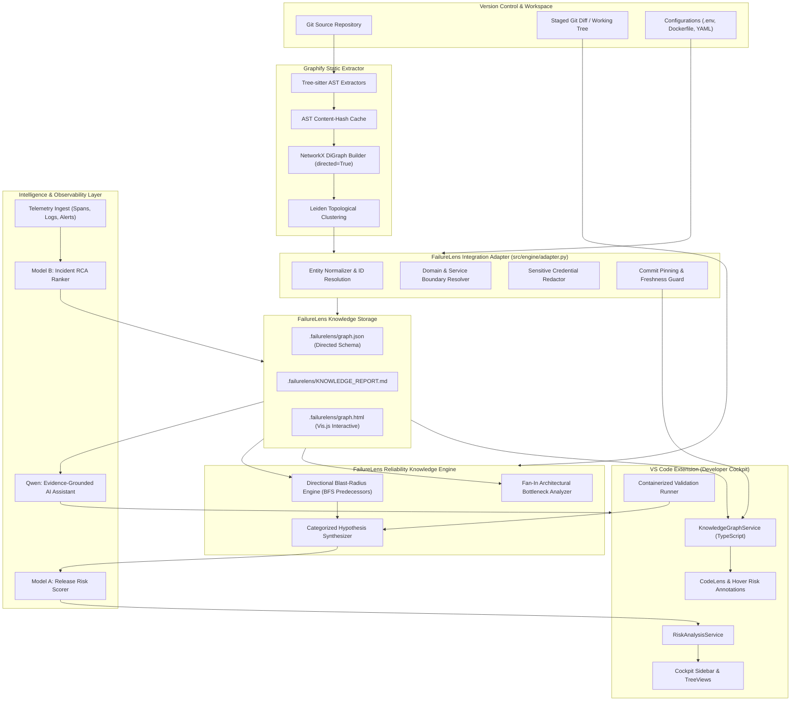
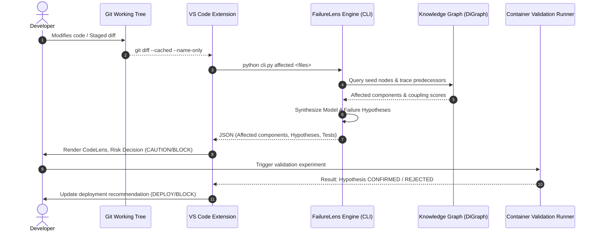
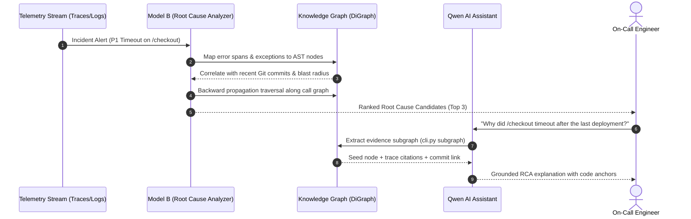
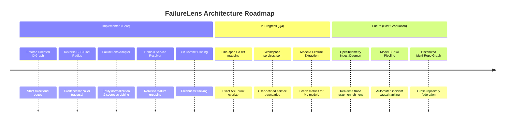

# FailureLens: Graphify Integration & Reliability Architecture Specification

> **Version**: 1.0.0  
> **Status**: Approved & Implemented  
> **Target Audience**: Core Engineering Team, Graduation Project Evaluators, System Architects  
> **Canonical Reference**: [FailureLens System Architecture](file:///d:/MIU/Graduation%20Project/Code/FailureLens/docs/GRAPHIFY_INTEGRATION_AND_FAILURELENS_ARCHITECTURE.md)

---

## 1. Introduction

### 1.1 Purpose of Graphify in FailureLens
**FailureLens** is an AI-driven, change-aware reliability platform designed to unify pre-deployment failure prevention (forward reasoning) with post-deployment incident root-cause diagnosis (backward reasoning).

At the foundation of any change-aware reliability engine lies a fundamental question:
> *When an engineer alters a line of code or a configuration variable, what downstream application components, interfaces, and operational dependencies can realistically fail?*

To answer this question deterministically without brute-force runtime tracing of every commit, FailureLens integrates **Graphify** as its static repository knowledge-graph generation and relationship-discovery layer. Graphify parses multi-language source trees into an Abstract Syntax Tree (AST) graph, resolves symbol-level relationships (`calls`, `imports`, `references`, `inherits`), and clusters related modules into structural communities.

### 1.2 The Strategic Architectural Choice: In-Memory Directed Graph vs. Neo4j
A frequent architectural temptation in knowledge-graph systems is to prematurely deploy an enterprise graph database such as Neo4j. For FailureLens, **Neo4j was deliberately evaluated and rejected** for the current architecture in favor of Graphify's NetworkX-backed in-memory directed graph (`nx.DiGraph`) paired with Git-pinned on-disk JSON serialization:

1. **Zero Deployment Footprint & Frictionless Developer Onboarding**:
   - FailureLens operates directly inside a developer's IDE (VS Code extension) and local CI pipelines.
   - Requiring Neo4j would force every developer to run a persistent JVM process or local Docker container daemon just to compute blast radius, dramatically complicating local testing and CI/CD adoption.
2. **Deterministic Time-Travel Snapshots Linked to Git**:
   - Graphify stores the serialized graph in `.failurelens/graph.json` stamped with `built_at_commit`.
   - Branch switches, rollbacks, and historical PR audits require no database migrations or multi-tenant database partitions—graphs snapshot naturally alongside the codebase.
3. **Extreme Traversal Performance at Repository Scale**:
   - For a monolithic or microservice repository containing 50,000 nodes and 200,000 dependencies, NetworkX retains the entire graph in under **75 MB of RAM**.
   - Breadth-First Search (BFS) and reverse-dependency blast-radius calculations execute in **< 4 milliseconds**, enabling instant CodeLens annotations and real-time hover cards while typing.

Neo4j remains an option for future enterprise scaling where multi-organization distributed services span hundreds of separate repositories, but for workspace-level and service-level reliability intelligence, NetworkX + JSON + Adapter provides superior agility and determinism.

---

## 2. Graphify's Role and Responsibilities

Graphify provides the foundational static repository map. It is strictly decoupled from operational runtime logic.

### 2.1 Core Responsibilities (What Graphify Does)
- **Multi-Language AST Ingestion**: Parses code files across Python, TypeScript, JavaScript, Go, Rust, Java, C#, SQL, Terraform, and YAML using Tree-sitter parsers (`src/engine/core/extractors/`).
- **Symbol & Identifier Normalization**: Creates deterministic, Unicode-normalized IDs for functions, methods, classes, and files (`src/engine/core/ids.py`) that remain stable across rebuilds.
- **Static Relationship Discovery**: Traces directional calls, module imports, class extensions, and variable references.
- **Topological Clustering**: Runs Leiden community detection (`src/engine/core/cluster.py`) to partition the graph into cohesive topological clusters.
- **Incremental AST Caching**: Hashing source files to avoid re-extracting unchanged files (`graphify-out/cache/ast`).

### 2.2 Strict Non-Responsibilities (What Graphify Does NOT Do)
- ❌ Does not evaluate failure propagation or operational blast radius.
- ❌ Does not map code symbols to deployed microservices or runtime endpoints.
- ❌ Does not analyze Git diffs or staging status.
- ❌ Does not generate failure hypotheses or predict release risk.
- ❌ Does not ingest OpenTelemetry traces, Prometheus metrics, or incident logs.
- ❌ Does not rank root causes or guide AI assistant reasoning.

*All operational and reliability intelligence is exclusively owned by FailureLens.*

---

## 3. Current Implementation State & Audit Findings

The following table reflects the actual state of the repository following the comprehensive integration audit and Phase 1/Phase 2 fixes:

| Subsystem | Source Component | Initial Audit Status | Applied Resolution / Current State |
| :--- | :--- | :--- | :--- |
| **Graph Construction** | `src/engine/cli.py`<br>`src/engine/adapter.py` | **Defective** (`directed=False` default created undirected `nx.Graph`) | **Fixed**: Enforced `directed=True` in `build_from_json`, outputs directed `nx.DiGraph` with directional edge validation. |
| **Blast Radius Traversal** | `src/engine/blast_radius.py` | **Defective** (Fell back to `G.neighbors()`, traversed callees bidirectionally, treated `contains` as failure) | **Fixed**: Strict reverse BFS via `G.predecessors()`; filtered out structural containment; differentiated direct calls vs imports. |
| **Engine Code Duplication** | `src/engine/`<br>`extension/engine/` | **High Risk** (Identical copies; extension prioritized bundled over workspace) | **Fixed**: Established `src/engine/` as canonical source of truth; updated `knowledgeGraphService.ts` to prioritize workspace engine; added `sync-engine` npm script. |
| **Feature Domain Naming** | `src/engine/adapter.py` | **Flawed** (Checked `parts[1]`, naming all extension communities `"Feature: Src"`) | **Fixed**: Implemented `resolve_service_name` in adapter, skipping generic folders (`src`, `lib`) to produce realistic domain names (`Services`, `Providers`, `Db`). |
| **Git Commit Pinning** | `src/engine/adapter.py`<br>`knowledgeGraphService.ts` | **Partial** (`built_at_commit` stored but never verified) | **Fixed**: Extension verifies graph `built_at_commit` against `git rev-parse HEAD` and sets `isStale` flag. |
| **Adapter Boundary** | `src/engine/adapter.py` | **Missing** (Raw dictionaries consumed everywhere) | **Implemented**: `FailureLensGraphAdapter` normalizes nodes, sanitizes secrets, and builds Qwen context subgraphs. |
| **Secret Sanitization** | `src/engine/adapter.py` | **Vulnerable** (Config values ingested as plaintext) | **Implemented**: Automatic regex scrubber redacting tokens, keys, passwords while retaining config keys. |

---

## 4. FailureLens Architecture Around Graphify

### 4.1 System Architecture Diagram



### 4.2 Subsystem Integration Boundaries
1. **Graphify $\to$ Adapter**:
   - Graphify takes source files and outputs a raw directed NetworkX graph.
   - The Adapter sanitizes sensitive tokens and maps AST paths into domain service entities.
2. **Adapter $\to$ Knowledge Engine**:
   - The Knowledge Engine queries the Adapter to obtain `G` as an authenticated `nx.DiGraph`.
   - Blast-radius traversal operates strictly over incoming caller edges (`predecessors`).
3. **Knowledge Engine $\to$ VS Code Extension**:
   - The CLI (`src/engine/cli.py`) emits structured, validated JSON consumed by `KnowledgeGraphService.ts`.
   - CodeLens markers dynamically bind affected components to editor lines.
4. **Knowledge Engine $\to$ Qwen AI Assistant**:
   - The CLI `subgraph` command extracts an evidence-grounded markdown subgraph, preventing hallucination by constraining Qwen's reasoning to verified topological and telemetry facts.

---

## 5. Graph Data Model & Relationship Semantics

### 5.1 Node Schema
Each node in `.failurelens/graph.json` conforms to the normalized FailureLens specification:

```json
{
  "id": "src_db_pool_connectionpool",
  "label": "ConnectionPool",
  "_callable": true,
  "_callable_class": true,
  "_origin": "ast",
  "entity_type": "class",
  "source_file": "src/db/pool.py",
  "source_location": "L11",
  "service_name": "Db Service",
  "community": 7,
  "community_name": "Feature: Db",
  "coupling_score": 39,
  "is_critical": false
}
```

### 5.2 Relationship Types and Directionality

| Relationship | Graph Direction ($u \to v$) | Failure Impact Direction | Traversal Rule |
| :--- | :--- | :--- | :--- |
| `calls` | `Caller -> Callee` | If Callee changes, Caller may break. | Follow **incoming** edges (`G.predecessors(callee)`). |
| `inherits` / `extends` | `Derived -> Base` | If Base changes, Derived contract breaks. | Follow **incoming** edges (`G.predecessors(base)`). |
| `imports` / `imports_from` | `Module -> ImportedSymbol` | If ImportedSymbol changes, Module may break. | Follow **incoming** edges (`G.predecessors(imported)`). |
| `references` | `User -> Constant/Field` | If Field changes, User may break. | Follow **incoming** edges (`G.predecessors(field)`). |
| `contains` / `method` | `File/Class -> Member` | Structural containment only. | **EXCLUDED** from failure propagation to prevent cycles. |
| `configures` | `Config -> Service` | If Config changes, Service behavior drifts. | Follow **outgoing** edges (`G.successors(config)`). |
| `observed_in` | `TelemetrySpan -> Function` | Runtime execution trace evidence. | Binds trace spans to AST symbols. |
| `caused_by` | `Incident -> Component` | Validated historical post-mortem link. | Ingested into Reliability Knowledge Base. |

---

## 6. Pre-Deployment Usage (Forward Reasoning)

### The Pre-Deployment Workflow



1. **Change Discovery**: `git diff --cached` identifies modified files and changed line numbers.
2. **Seed Node Resolution**: Adapter matches changed lines against AST node boundaries.
3. **Directional Blast-Radius Traversal**:
   - Level 0 (`DIRECT`): The modified symbols themselves.
   - Level 1 (`HIGH`): Direct callers invoking modified symbols via `calls` or `inherits`.
   - Level 2 (`MEDIUM`): Transitive callers (callers of callers) up to configured depth limit.
4. **Hypothesis Synthesis**:
   - *Resource Saturation*: Changes in pool/lock/queue components with concurrent callers.
   - *Contract Drift*: Changes in exported method contracts consumed across module boundaries.
   - *Cascading Timeout*: Dependencies crossing feature/service community boundaries.
5. **Validation & Gating**: Containerized Docker runner executes targeted tests. Confirmed hypotheses trigger `BLOCK` recommendations.

---

## 7. Post-Deployment Usage (Backward Reasoning & RCA)

### The Post-Deployment Incident RCA Workflow



1. **Telemetry Grounding**: OpenTelemetry trace spans and exception stack traces are mapped to canonical AST node IDs in the graph.
2. **Failure Propagation Tracing**: If Service A throws 504 Gateway Timeout, the engine traverses downstream outgoing edges (`calls`) to identify whether degraded database pools or cache misses in Service B initiated the latency cascade.
3. **Commit Correlation**: Intersects candidate nodes with recent Git commits from pre-deployment knowledge snapshots.
4. **Root-Cause Ranking**: Model B calculates confidence scores combining graph proximity, anomaly magnitude, and recent change history.
5. **Evidence Grounding**: Findings are persisted to the Reliability Knowledge Base for citation during future incidents.

---

## 8. LLM Grounding Strategy (Qwen AI Assistant)

To eliminate AI hallucinations, FailureLens enforces strict **evidence grounding**:

1. **Context Subgraph Extraction**:
   - The CLI provides `python cli.py subgraph <ws> --nodes <seed_ids> --depth 2`.
   - Extracts the exact topological neighborhood, including caller relationships, file paths, line ranges, and service names.
2. **Prompt Injection Format**:
   - The extracted subgraph is formatted into a concise markdown citation block injected into Qwen's system context:
   ```markdown
   ### FailureLens Architectural Knowledge Citations
   - **[MODIFIED SEED]** `ConnectionPool` (`src/db/pool.py:L11`) | Service: `Db Service`
   - **[DEPENDENT]** `.handle_checkout_request()` (`worker.py:L12`) | Service: `Checkout Service`
   
   **Observed Structural Dependencies**:
   - `worker_handle_checkout` --[calls]--> `src_db_pool_connectionpool_acquire_connection`
   ```
3. **Strict Citation Constraint**:
   - Qwen is instructed to reference only verified nodes and edge relations present in the citation block. If an explanation cannot be grounded in the indexed graph, Qwen explicitly reports missing telemetry evidence rather than guessing.

---

## 9. Limitations & Design Considerations

1. **Static vs. Runtime Dynamic Relationships**:
   - Static AST analysis cannot resolve dynamic runtime polymorphism, reflective method invocation, or runtime string-dispatched RPCs without runtime trace enrichment.
2. **Topological Communities vs. True Microservice Boundaries**:
   - Graphify's Leiden clustering partitions code by modularity. While indicative of functional cohesion, it does not strictly equal container or process boundaries. The FailureLens Adapter enriches these with path-based service heuristics.
3. **Dependency vs. Causality**:
   - A static `calls` edge indicates structural capability to invoke, not guaranteed failure propagation. FailureLens marks pre-deployment hypotheses as `UNTESTED` until verified by containerized experiments or telemetry evidence.
4. **Graph Freshness & Stale Detection**:
   - The knowledge graph must be re-synced when significant file modifications occur. The extension tracks `built_at_commit` against Git `HEAD` to alert engineers when the index is stale.

---

## 10. Implementation Roadmap



---

## 11. Source Code Reference Index

| Architectural Concept | Primary Implementation File |
| :--- | :--- |
| **FailureLens Adapter Layer** | [`src/engine/adapter.py`](file:///d:/MIU/Graduation%20Project/Code/FailureLens/src/engine/adapter.py) |
| **Directional Blast Radius** | [`src/engine/blast_radius.py`](file:///d:/MIU/Graduation%20Project/Code/FailureLens/src/engine/blast_radius.py) |
| **Architectural Centrality & Hypotheses** | [`src/engine/analyzer.py`](file:///d:/MIU/Graduation%20Project/Code/FailureLens/src/engine/analyzer.py) |
| **Engine Command-Line Interface** | [`src/engine/cli.py`](file:///d:/MIU/Graduation%20Project/Code/FailureLens/src/engine/cli.py) |
| **Codebase File Discovery** | [`src/engine/detector.py`](file:///d:/MIU/Graduation%20Project/Code/FailureLens/src/engine/detector.py) |
| **Interactive Graph Visualizer** | [`src/engine/visualizer.py`](file:///d:/MIU/Graduation%20Project/Code/FailureLens/src/engine/visualizer.py) |
| **VS Code Knowledge Graph Service** | [`extension/src/services/knowledgeGraphService.ts`](file:///d:/MIU/Graduation%20Project/Code/FailureLens/extension/src/services/knowledgeGraphService.ts) |
| **VS Code Risk Analysis Service** | [`extension/src/services/riskAnalysisService.ts`](file:///d:/MIU/Graduation%20Project/Code/FailureLens/extension/src/services/riskAnalysisService.ts) |
| **VS Code CodeLens & Hover Provider** | [`extension/src/providers/codeLensProvider.ts`](file:///d:/MIU/Graduation%20Project/Code/FailureLens/extension/src/providers/codeLensProvider.ts) |
| **VS Code Interactive Graph Webview** | [`extension/src/providers/graphWebviewPanel.ts`](file:///d:/MIU/Graduation%20Project/Code/FailureLens/extension/src/providers/graphWebviewPanel.ts) |
| **Graphify AST Extractors** | [`src/engine/core/extractors/`](file:///d:/MIU/Graduation%20Project/Code/FailureLens/src/engine/core/extractors/) |
| **Graphify NetworkX Builder** | [`src/engine/core/build.py`](file:///d:/MIU/Graduation%20Project/Code/FailureLens/src/engine/core/build.py) |
| **Graphify Node Identifier Normalizer** | [`src/engine/core/ids.py`](file:///d:/MIU/Graduation%20Project/Code/FailureLens/src/engine/core/ids.py) |
